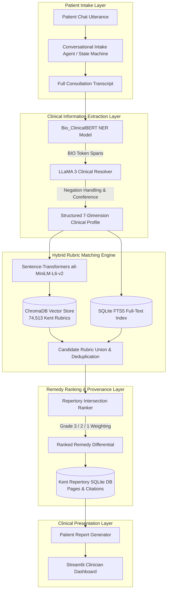

# Kent-AI — Architecture Context

> Last updated: 2026-10-29 by Antigravity
> Phase: Complete through Phase 5 / Phase B & C (Two-Stage Pipeline & Evaluation Suite Operational; 70 Unit & Integration Tests Passing)

---

## Repository Tree (Implemented Modules)

```
kent-ai/
├── Context/                       # AI agent context files (you are here)
├── configs/                       # YAML configuration — never hardcode params
│   ├── model.yaml                 # Bio_ClinicalBERT hyperparams + BIO label schema
│   ├── generation.yaml            # LLaMA 3 case generation settings + split ratios
│   ├── chromadb.yaml              # Vector store embedding model + distance metric
│   └── chatbot.yaml               # State machine states + dialogue persona rules
│
├── data/
│   ├── raw/
│   │   ├── repertory.sqlite               # Primary data source (112 MB)
│   │   └── kent_public_edition/           # Upstream digitized repertory bundle
│   │       ├── repertory.sqlite           # Primary database
│   │       ├── schema.sql                 # DDL for all tables, views, FTS indexes
│   │       ├── viewer.py                  # Standalone local browser
│   │       ├── query.py                   # CLI query tool
│   │       ├── sections.json              # Section metadata export
│   │       ├── remedies.json              # Remedy dictionary export
│   │       └── manifest.json              # Upstream bundle manifest
│   ├── processed/                         # Generated artifacts: 19,732 cases (mind_cases.jsonl, train/val/test.jsonl)
│   ├── embeddings/kent_rubrics/           # ChromaDB persistent HNSW index (74,513 rubrics, Phase 2)
│   └── models/clinicalbert_homeoNER/      # Fine-tuned Bio_ClinicalBERT weights (411MB model.safetensors, Phase 3)
│
├── src/
│   ├── __init__.py                # Package root; exports __version__ = "0.1.0"
│   ├── config.py                  # YAML loader + project root detection
│   │
│   ├── data/
│   │   ├── __init__.py            # Re-exports all kent_db public API
│   │   ├── kent_db.py             # ★ CORE: SQLite DAL — fully implemented
│   │   ├── case_generator.py      # ★ CORE: LLaMA synthetic case pipeline (Ollama REST + Mock) — implemented
│   │   ├── bio_tagger.py          # ★ CORE: BIO token tagger with offset repair — implemented
│   │   └── splitter.py            # ★ CORE: 80/10/10 stratified deficit splitter — implemented
│   │
│   ├── models/
│   │   ├── symptom_ner.py         # ★ CORE: Bio_ClinicalBERT wrapper with subword inference & mock fallback — implemented
│   │   ├── trainer.py             # ★ CORE: Bio_ClinicalBERT fine-tuning loop with SeqEval & early stopping — implemented
│   │   └── resolver.py            # ★ CORE: LLaMA post-processor & negation resolver (Phase 4) — implemented
│   │
│   ├── search/
│   │   ├── embedder.py            # ★ CORE: Sentence-transformers embedder (Phase 2) — implemented
│   │   ├── vector_store.py        # ★ CORE: ChromaDB wrapper with HNSW cosine index (Phase 2) — implemented
│   │   └── ranker.py              # ★ CORE: Remedy intersection & grade ranker (Phase 5) — implemented
│   │
│   ├── chatbot/
│   │   ├── state_machine.py       # ★ CORE: FSM with IntakeState enum & adaptive slot skipping (Phase 6) — implemented
│   │   ├── dialogue_manager.py    # ★ CORE: Multi-turn dialogue manager with LLaMA 3 (Phase 6) — implemented
│   │   └── prompts.py             # Prompt templates (case gen, resolver, chatbot) — active
│   │
│   ├── pipeline/
│   │   ├── orchestrator.py        # ★ CORE: End-to-end transcript→report orchestrator (Phase 5) — implemented
│   │   └── report_generator.py    # ★ CORE: JSON + Markdown reports (Phase 5) — implemented
│   │
│   └── dashboard/
│       ├── app.py                 # ★ CORE: Streamlit 4-workspace clinical portal with Totality Matrix (Phase 7) — implemented
│       ├── dimensions.py          # ★ CORE: Canonical DIMENSION_MAP & pluralization helpers — implemented
│       ├── styles.py              # ★ CORE: Google Stitch CSS injection, pulse glow, cards (Phase 7) — implemented
│       ├── styles.css             # ★ CORE: Google Stitch CSS styles (midnight canvas #0A0F1D) — implemented
│       └── components/
│           ├── rubric_tree.py     # ★ CORE: Rubric cards with expandable 3-grade remedy inspector (Phase 7) — implemented
│           ├── chat_viewer.py     # ★ CORE: Multi-turn chat HUD with live slot pills & suggestions (Phase 7) — implemented
│           └── icons.py           # ★ CORE: Icon rendering helpers — implemented
│
├── scripts/
│   ├── generate_cases.py          # CLI: full production case generator with --split and --resume
│   ├── generate_pilot_sample.py   # CLI: stratified 100-case pilot generator across 25 MIND rubrics
│   ├── audit_pilot.py             # CLI: statistical audit (BIO offset accuracy, Jaccard diversity)
│   ├── run_gpu_generation.sh      # Bash: turnkey automated runner for College GPU cluster
│   ├── build_embeddings.py        # CLI: ChromaDB persistent vector indexer (74,513 rubrics)
│   ├── train_ner.py               # CLI: Bio_ClinicalBERT HomeoNER training
│   ├── monitor_training.py        # CLI: live GPU training progress monitor
│   ├── chat_intake.py             # CLI: interactive patient consultation with 10-state FSM
│   ├── evaluate.py                # CLI: academic benchmark evaluation (SeqEval BIO F1, Recall@K, MRR, Remedy Acc)
│   └── export_model.py            # CLI: model artifact packaging
│
├── notebooks/
│   ├── 01_eda_repertory.ipynb     # EDA: sections, MIND depths, grades, search demo
│   └── 02_case_generation_demo.ipynb # Interactive case generation & BIO inspection
│
├── tests/                         # ★ 70 passing unit tests across 13 test modules
│   ├── test_kent_db.py            # SQLite reader, views, FTS5 queries (13 tests)
│   ├── test_bio_tagger.py         # Subword alignment & character offset repair (6 tests)
│   ├── test_case_generator.py     # LLaMA 3 prompting & JSON parsing (3 tests)
│   ├── test_splitter.py           # 80/10/10 deficit-balancing split algorithm (4 tests)
│   ├── test_symptom_ner.py        # Tokenizer, subword tags & entity extraction (5 tests)
│   ├── test_vector_store.py       # ChromaDB HNSW cosine retrieval & section filter (6 tests)
│   ├── test_resolver.py           # SymptomProfile, negation & search queries (4 tests)
│   ├── test_ranker.py             # Remedy totality scoring & grade weighting (5 tests)
│   ├── test_pipeline.py           # End-to-end transcript-to-report pipeline & two-stage flow (5 tests)
│   ├── test_evaluation.py         # Academic evaluation suite, BIO metrics & report export (3 tests)
│   ├── test_state_machine.py      # 10-state intake FSM & slot transitions (6 tests)
│   ├── test_dialogue_manager.py   # Dialogue context & turn tracking (5 tests)
│   └── test_dashboard.py          # Slot badges, Totality Matrix & report export (5 tests)
│
├── docs/
│   ├── Next_Steps.md              # Supervisor meeting briefing & roadmap (Dr. Arya)
│   ├── GPU_SETUP_GUIDE.md         # College GPU cluster SSH execution guide
│   ├── DESIGN.md                  # Google Stitch UI/UX design tokens & CSS spec
│   ├── Evaluation/                # Mid-semester evaluation, thesis materials & pilot study
│   │   ├── Pilot/                 # 100-case pilot evaluation report & generation log
│   │   ├── Mid_Sem/               # Mid-semester presentation, reports, and PDFs
│   │   └── End_Sem/               # Final semester thesis and evaluation suite
│   ├── Papers/                    # Academic literature & reference papers
│   └── Proposals/                 # Original project proposals

│
├── pyproject.toml                 # Build config, deps, pytest settings
├── Makefile                       # Shortcut targets: test, lint, serve, etc.
├── .gitignore                     # Excludes .venv, *.sqlite, *.gz, model weights
└── LICENSE                        # MIT
```

### Legend

- **★ CORE** = Fully implemented and tested
- **Stub** = File exists with typed interfaces, raises `NotImplementedError`

---

## Data Flow (End-to-End Pipeline)



```
Patient utterance
    │
    ▼
┌──────────────────────────┐
│  Chatbot State Machine   │  src/chatbot/state_machine.py
│  (GREETING → ... → DONE)│  src/chatbot/dialogue_manager.py
└──────────┬───────────────┘
           │ Full transcript
           ▼
┌──────────────────────────┐
│  Bio_ClinicalBERT NER    │  src/models/symptom_ner.py
│  Token-level BIO tagging │
└──────────┬───────────────┘
           │ Raw entity spans
           ▼
┌──────────────────────────┐
│  LLaMA 3 Resolver        │  src/models/resolver.py
│  Negation + Coreference  │
└──────────┬───────────────┘
           │ Structured 7-dim JSON
           ▼
┌──────────────────────────┐
│  Hybrid Retrieval        │
│  ChromaDB dense search   │  src/search/vector_store.py
│  + SQLite FTS5 search    │  src/data/kent_db.search_rubrics()
└──────────┬───────────────┘
           │ Candidate rubric IDs
           ▼
┌──────────────────────────┐
│  Remedy Ranker           │  src/search/ranker.py
│  Grade-weighted scoring  │
└──────────┬───────────────┘
           │ Ranked remedy list
           ▼
┌──────────────────────────┐
│  Report Generator        │  src/pipeline/report_generator.py
│  JSON + Markdown output  │
└──────────┬───────────────┘
           │
           ▼
┌──────────────────────────┐
│  Streamlit Dashboard     │  src/dashboard/app.py
│  Doctor reviews results  │
└──────────────────────────┘
```

---

## Key Module API Summary

### `src.config`

| Function | Returns | Notes |
|---|---|---|
| `get_project_root()` | `Path` | Traverses up from file to find `pyproject.toml` |
| `load_config(name)` | `dict` | Loads `configs/{name}.yaml` via `yaml.safe_load` |
| `get_model_config()` | `dict` | Shortcut for `load_config("model")` |
| `get_generation_config()` | `dict` | Shortcut for `load_config("generation")` |
| `get_chromadb_config()` | `dict` | Shortcut for `load_config("chromadb")` |
| `get_chatbot_config()` | `dict` | Shortcut for `load_config("chatbot")` |

### `src.data.kent_db`

| Function | Returns | Notes |
|---|---|---|
| `get_db_path(explicit=None)` | `Path` | Resolves DB via arg → env → `data/raw/` → `kent_public_edition/` |
| `get_connection(db_path=None)` | Context manager → `sqlite3.Connection` | Read-only, `PRAGMA query_only=ON` |
| `get_sections()` | `list[dict]` | 37 sections with `rubric_count` |
| `get_rubrics(section_id, parent_id, limit, offset)` | `list[dict]` | `parent_id=-1` for roots |
| `get_rubric_by_id(id)` | `dict | None` | Single rubric lookup |
| `get_rubric_path(id)` | `str` | e.g., `"MIND > ABANDONED > feels he is"` |
| `get_remedies(rubric_id)` | `list[dict]` | Grade via `COALESCE(grade, grade_candidate, 1)` |
| `get_mind_rubrics(limit, offset)` | `list[dict]` | Shortcut for `section_id=1` |
| `search_rubrics(query, section_id, limit, offset)` | `list[dict]` | FTS5 prefix → LIKE fallback |
| `KentDB` class | OOP wrapper | Delegates to module-level functions |

---

## Configuration Files

All configuration lives in `configs/`. Loaded via `src.config.load_config()`.

| File | Top-level Keys | Critical Values |
|---|---|---|
| `model.yaml` | `model`, `training`, `labels` | 15 BIO tags, lr=2e-5, patience=3 |
| `generation.yaml` | `generation`, `target_data`, `splits` | section_id=1, 4 cases/rubric, 80/10/10 |
| `chromadb.yaml` | `vector_store`, `embedding_model`, `search` | cosine distance, top_k=20 |
| `chatbot.yaml` | `chatbot`, `state_machine`, `dialogue` | 10 FSM states, max 15 turns |

---

_End of file._
