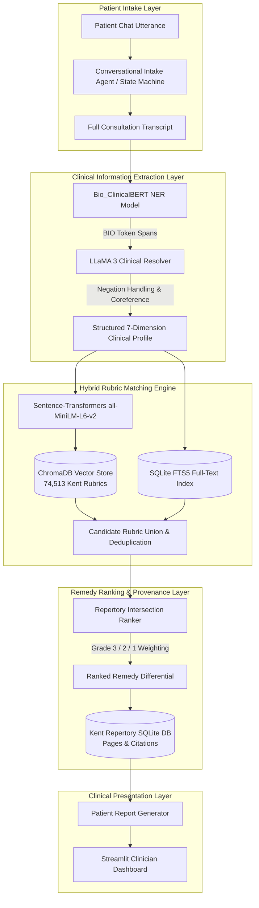

# Kent-AI — Architecture Context

> Last updated: 2026-11-01 by Antigravity
> Phase: Complete through Phase 15 (Comprehensive Clinician UI/UX Overhaul, Phases 1–10; 168 Unit & Integration Tests Passing across 18 Test Modules, 0 Errors)

---

## Repository Tree (Implemented Modules)

```
kent-ai/
├── Context/                       # AI agent context files (you are here)
├── configs/                       # YAML configuration — never hardcode params
│   ├── model.yaml                 # Bio_ClinicalBERT hyperparams + BIO label schema
│   ├── generation.yaml            # LLaMA 3 case generation settings + split ratios
│   ├── chromadb.yaml              # Vector store embedding model + distance metric
│   └── chatbot.yaml               # State machine states + dialogue persona rules
│
├── data/
│   ├── raw/
│   │   ├── repertory.sqlite               # Primary data source (112 MB)
│   │   └── kent_public_edition/           # Upstream digitized repertory bundle
│   │       ├── repertory.sqlite           # Primary database
│   │       ├── schema.sql                 # DDL for all tables, views, FTS indexes
│   │       ├── viewer.py                  # Standalone local browser
│   │       ├── query.py                   # CLI query tool
│   │       ├── sections.json              # Section metadata export
│   │       ├── remedies.json              # Remedy dictionary export
│   │       └── manifest.json              # Upstream bundle manifest
│   ├── cases.sqlite                       # SQLite case store: patient records, totality, active rubrics (Phase 11)
│   ├── processed/                         # Generated artifacts: 19,732 cases (mind_cases.jsonl, train/val/test.jsonl)
│   ├── embeddings/kent_rubrics/           # ChromaDB persistent HNSW index (74,513 rubrics, Phase 2)
│   └── models/                            # Fine-tuned & PEFT adapter checkpoints
│       ├── clinicalbert_homeoNER/         # Fine-tuned Bio_ClinicalBERT weights (411MB model.safetensors, Phase 3)
│       ├── biolinkbert_homeoNER/          # Fine-tuned BioLinkBERT weights (top token BIO F1 34.86%, Phase 8)
│       ├── pubmedbert_homeoNER/           # Fine-tuned PubMedBERT weights (top dense recall 41.56%, Phase 8)
│       ├── deberta_homeoNER/              # Fine-tuned DeBERTa-v3 weights (Phase 8)
│       ├── qwen_homeoQLoRA/               # 4-bit QLoRA adapter for Qwen 2.5 7B (78MB adapter_model.safetensors, Phase 9)
│       └── biomistral_homeoQLoRA/         # 4-bit QLoRA adapter for BioMistral 7B (81MB adapter_model.safetensors, Phase 9.1)
│
├── src/
│   ├── __init__.py                # Package root; exports __version__ = "0.1.0"
│   ├── config.py                  # YAML loader + project root detection
│   │
│   ├── data/
│   │   ├── __init__.py            # Re-exports all kent_db public API
│   │   ├── kent_db.py             # ★ CORE: SQLite DAL — fully implemented
│   │   ├── case_store.py          # ★ CORE: Persistent SQLite case store (cases.sqlite) — implemented (Phase 11)
│   │   ├── case_generator.py      # ★ CORE: LLaMA synthetic case pipeline (Ollama REST + Mock) — implemented
│   │   ├── bio_tagger.py          # ★ CORE: BIO token tagger with offset repair — implemented
│   │   └── splitter.py            # ★ CORE: 80/10/10 stratified deficit splitter — implemented
│   │
│   ├── models/
│   │   ├── case.py                # ★ CORE: ClinicalCase dataclass (single typed source of truth) — implemented (Phase 11)
│   │   ├── symptom_ner.py         # ★ CORE: Bio_ClinicalBERT wrapper with subword inference & mock fallback — implemented
│   │   ├── trainer.py             # ★ CORE: Multi-encoder fine-tuning loop with SeqEval & early stopping — implemented
│   │   ├── resolver.py            # ★ CORE: LLaMA post-processor & negation resolver (Phase 4) — implemented
│   │   ├── llm_dataset.py         # ★ CORE: Instruction dataset transformer for 7-dim clinical PEFT — implemented
│   │   ├── ensemble.py            # ★ CORE: Weighted majority voting & IoU span clustering (Paradigm 1) — implemented
│   │   └── hybrid_pipeline.py     # ★ CORE: Two-stage hybrid pipeline with LLM arbitration (Paradigm 2) — implemented
│   │
│   ├── search/
│   │   ├── embedder.py            # ★ CORE: Sentence-transformers embedder (Phase 2) — implemented
│   │   ├── vector_store.py        # ★ CORE: ChromaDB wrapper with HNSW cosine index (Phase 2) — implemented
│   │   └── ranker.py              # ★ CORE: Remedy intersection & grade ranker (Phase 5) — implemented
│   │
│   ├── chatbot/
│   │   ├── state_machine.py       # ★ CORE: FSM with IntakeState enum, advance_to_next_gap & denied_slots (Phase 6 & 14) — implemented
│   │   ├── dialogue_manager.py    # ★ CORE: Multi-turn dialogue manager with resume_from_case, undo & safety screening (Phase 6, 12, 14) — implemented
│   │   ├── turn_history.py        # ★ CORE: Turn capture diffs, opener generation & undo helpers (Phase 14) — implemented
│   │   ├── fallbacks.py           # ★ CORE: Deterministic FSM offline response templates (Phase 14) — implemented
│   │   ├── answer_palettes.py     # ★ CORE: Standardized Kentian vocabulary palettes per active state (Phase 14) — implemented
│   │   ├── suggestions.py         # ★ CORE: Dynamic suggestion generator with Skip & None of these chips (Phase 6, 12, 14) — implemented
│   │   ├── slot_extractor.py      # ★ CORE: 3-tier slot extraction pipeline (Phase 6) — implemented
│   │   ├── ollama_client.py       # ★ CORE: Resilient streaming Ollama HTTP client (Phase 6 & 12) — implemented
│   │   └── prompts.py             # Prompt templates (case gen, resolver, chatbot bedside persona) — active
│   │
│   ├── pipeline/
│   │   ├── orchestrator.py        # ★ CORE: End-to-end transcript→report orchestrator, extract_profile & rescore_report (Phase 5, 11, 13) — implemented
│   │   ├── narrative.py           # ★ CORE: Chief complaint derivation & missing recommended dimensions (Phase 13) — implemented
│   │   ├── safety.py              # ★ CORE: Red flag clinical safety regex screening with negation awareness (Phase 13) — implemented
│   │   ├── case_summarizer.py     # ★ CORE: Local LLM physician brief & patient narrative summarizer (Phase 12) — implemented
│   │   └── report_generator.py    # ★ CORE: JSON + Markdown reports (Phase 5) — implemented
│   │
│   └── dashboard/
│       ├── app.py                 # ★ CORE: Streamlit 6-tab clinical portal with 4-step stepper (Phase 7, 11, 15) — implemented
│       ├── constants.py           # ★ CORE: Single source of truth for 7 canonical dimensions, grade weights, scope counts, model display name & evaluation benchmarks (Phase 15) — implemented
│       ├── totality_ring.py       # ★ CORE: Reusable 7-segment SVG totality ring glyph (Phase 15) — implemented
│       ├── dimensions.py          # ★ CORE: Canonical DIMENSION_MAP & pluralization helpers — implemented
│       ├── examples.py            # ★ CORE: Clinical vignettes typed catalog for intake demonstrations (Phase 13) — implemented
│       ├── pdf_exporter.py        # ★ CORE: Multi-page clinical consultation PDF export via ReportLab 5.1 & PyMuPDF — implemented (Phase 11 & 14)
│       ├── styles.py              # ★ CORE: CSS injection & font definitions (Phase 7 & 15) — implemented
│       ├── styles.css             # ★ CORE: Ground-truth design tokens palette (:root), 2px focus-visible rings, printable report layout (Phase 15) — implemented
│       ├── utils.py               # ★ CORE: Mandatory HTML escaping esc() & safe fragment helpers — implemented
│       ├── views/
│       │   ├── step1_intake.py    # ★ CORE: Step 1 router & 7:3 bedside console with Case Snapshot rail (Phase 13 & 15) — implemented
│       │   ├── step1_paste.py     # ★ CORE: Step 1 paste clinical narrative intake with form & preview (Phase 13) — implemented
│       │   ├── step2_review.py    # ★ CORE: Step 2 clinical review & dimension validation (Phase 15) — implemented
│       │   ├── step3_analysis.py  # ★ CORE: Step 3 repertorization analysis & candidate comparison matrix (Phase 15) — implemented
│       │   ├── step4_report.py    # ★ CORE: Step 4 consolidated report & printable paper layout (Phase 15) — implemented
│       │   ├── explorer.py        # ★ CORE: Rubric Explorer with single-row hybrid search & Materia Medica modal inspection (Phase 15) — implemented
│       │   ├── materia_medica.py  # ★ CORE: Dedicated Materia Medica remedy keynotes browser (Phase 15) — implemented
│       │   ├── methodology.py     # ★ CORE: Dedicated Methodology & Kent Totality Principles reference (Phase 15) — implemented
│       │   └── settings.py        # ★ CORE: Dedicated Settings & live Ollama telemetry console (Phase 15) — implemented
│       └── components/
│           ├── header.py          # ★ CORE: Compact single-row top bar (<=56px) with leaf mark & engine status pill (Phase 15) — implemented
│           ├── case_bar.py        # ★ CORE: Persistent top case status bar with multi-line stepper buttons (Phase 11 & 15) — implemented
│           ├── action_bar.py      # ★ CORE: Reusable sticky bottom action bar (Phase 15) — implemented
│           ├── case_dialogs.py    # ★ CORE: Streamlit @st.dialog modals (Patient Info, Research Disclaimer, Materia Medica) (Phase 15) — implemented
│           ├── case_snapshot.py   # ★ CORE: Sticky 30% right rail for Case Workspace with inspection popovers (Phase 15) — implemented
│           ├── case_bulk_actions.py # ★ CORE: Multi-case selection, batch deletion, JSON bundle export & CSV summary (Phase 14 & 15) — implemented
│           ├── case_library.py    # ★ CORE: Saved consultation library with dual view (Cards/Table) & pagination (Phase 14 & 15) — implemented
│           ├── demo_case.py       # ★ CORE: Realistic MIND demonstration case generator (DEMO-MIND-001) (Phase 15) — implemented
│           ├── ollama_status.py   # ★ CORE: Fast 2-second dynamic daemon polling & round-trip ping latency (Phase 14 & 15) — implemented
│           ├── sidebar.py         # ★ CORE: Slim 296px sidebar with Active Case Card & persistent Case Tray (Phase 15) — implemented
│           ├── totality_grid.py   # ★ CORE: Classical Repertory Totality Matrix (rubrics×remedies, grades 3/2/1, Mute/Elim toggles) — implemented (Phase 11)
│           ├── extraction_preview.py # ★ CORE: Two-column highlighted narrative preview with overlap resolution (Phase 13) — implemented
│           ├── intake_guide.py    # ★ CORE: 6-item dynamic intake checklist & privacy guidance (Phase 13) — implemented
│           ├── remedy_comparison.py # ★ CORE: Differential Materia Medica side-by-side keynotes comparison — implemented (Phase 11)
│           ├── rubric_tree.py     # ★ CORE: Rubric cards with breadcrumbs, specificity badges & grade chips (Phase 15) — implemented
│           ├── chat_viewer.py     # ★ CORE: Bedside dialogue console orchestrator (<250 lines) (Phase 14 & 15) — implemented
│           ├── chat_header.py     # ★ CORE: Dialogue header with stage tracker, mode toggle & export popover (Phase 14 & 15) — implemented
│           ├── chat_messages.py   # ★ CORE: Accessible message stream, 28px avatars & collapsing welcome card (Phase 14 & 15) — implemented
│           ├── chat_actions.py    # ★ CORE: Docked review action bar with dynamic totality summary (Phase 14) — implemented
│           ├── chat_chips.py      # ★ CORE: Dynamic suggestion pills with neutral step-aware prompts (Phase 14 & 15) — implemented
│           └── icons.py           # ★ CORE: Material Design SVG icon helpers — implemented
│
├── scripts/
│   ├── generate_cases.py          # CLI: full production case generator with --split and --resume
│   ├── generate_pilot_sample.py   # CLI: stratified 100-case pilot generator across 25 MIND rubrics
│   ├── audit_pilot.py             # CLI: statistical audit (BIO offset accuracy, Jaccard diversity)
│   ├── run_gpu_generation.sh      # Bash: turnkey automated runner for College GPU cluster
│   ├── build_embeddings.py        # CLI: ChromaDB persistent vector indexer (74,513 rubrics)
│   ├── train_ner.py               # CLI: multi-model HomeoNER training with --model-name parameterization
│   ├── run_gpu_multi_train.sh     # Bash: automated training of PubMedBERT, BioLinkBERT, DeBERTa-v3
│   ├── train_llm_peft.py          # CLI: 4-bit QLoRA PEFT training for Qwen 2.5 and BioMistral
│   ├── evaluate_llm.py            # CLI: evaluation harness for generative decoders
│   ├── evaluate_ensemble.py       # CLI: evaluation harness for multi-model ensembles
│   ├── monitor_training.py        # CLI: live GPU training progress monitor
│   ├── chat_intake.py             # CLI: interactive patient consultation with 10-state FSM
│   ├── evaluate.py                # CLI: academic benchmark evaluation (SeqEval BIO F1, Recall@K, MRR, Remedy Acc)
│   └── export_model.py            # CLI: model artifact packaging
│
├── notebooks/
│   ├── 01_eda_repertory.ipynb     # EDA: sections, MIND depths, grades, search demo
│   └── 02_case_generation_demo.ipynb # Interactive case generation & BIO inspection
│
├── tests/                         # ★ 168 passing unit & integration tests across 18 test modules (0 errors, 0 warnings)
│   ├── test_kent_db.py            # SQLite reader, views, FTS5 queries (13 tests)
│   ├── test_case.py               # ClinicalCase model, extraction_meta, bulk operations, serialization & case_store SQLite CRUD (17 tests)
│   ├── test_bio_tagger.py         # Subword alignment & character offset repair (6 tests)
│   ├── test_case_generator.py     # LLaMA 3 prompting & JSON parsing (3 tests)
│   ├── test_splitter.py           # 80/10/10 deficit-balancing split algorithm (4 tests)
│   ├── test_symptom_ner.py        # Tokenizer, subword tags & entity extraction (5 tests)
│   ├── test_vector_store.py       # ChromaDB HNSW cosine retrieval & section filter (6 tests)
│   ├── test_resolver.py           # SymptomProfile, negation & search queries (4 tests)
│   ├── test_ranker.py             # Remedy totality scoring & grade weighting (5 tests)
│   ├── test_pipeline.py           # End-to-end transcript-to-report pipeline, extract_profile & two-stage flow (7 tests)
│   ├── test_evaluation.py         # Academic evaluation suite, BIO metrics & report export (3 tests)
│   ├── test_state_machine.py      # 10-state intake FSM & slot transitions (8 tests)
│   ├── test_dialogue_manager.py   # Multi-turn context, resume_from_case, streaming filter & slot sanitization (19 tests)
│   ├── test_dashboard.py          # Slot badges, Totality Matrix, report export, dynamic badges & transcript formatter (10 tests)
│   ├── test_app_smoke.py          # AppTest headless UI smoke tests, stepper, bulk selection, ASCII toast guards (11 tests)
│   ├── test_llm_dataset.py        # Generative instruction dataset formatting & schema adherence (8 tests)
│   ├── test_narrative.py          # Chief complaint derivation, recommended dimensions & highlight builder (8 tests)
│   ├── test_safety.py             # Red flag safety regex screening with negation awareness (3 tests)
│   └── test_ui_overhaul.py        # Design tokens, breadcrumbs, hybrid search, totality ring, dialogs & demo case (17 tests)
│
├── docs/
│   ├── Next_Steps.md              # Supervisor meeting briefing & roadmap (Dr. Arya)
│   ├── GPU_SETUP_GUIDE.md         # College GPU cluster SSH execution guide
│   ├── DESIGN.md                  # Google Stitch UI/UX design tokens & CSS spec
│   ├── Evaluation/                # Mid-semester evaluation, thesis materials & pilot study
│   │   ├── Pilot/                 # 100-case pilot evaluation report & generation log
│   │   ├── Mid_Sem/               # Mid-semester presentation, reports, and PDFs
│   │   └── End_Sem/               # Final semester thesis and evaluation suite
│   ├── Papers/                    # Academic literature & reference papers
│   └── Proposals/                 # Original project proposals

│
├── pyproject.toml                 # Build config, deps, pytest settings
├── Makefile                       # Shortcut targets: test, lint, serve, etc.
├── .gitignore                     # Excludes .venv, *.sqlite, *.gz, model weights
└── LICENSE                        # MIT
```

### Legend

- **★ CORE** = Fully implemented and tested
- **Stub** = File exists with typed interfaces, raises `NotImplementedError`

---

## Data Flow (End-to-End Pipeline)



```
Patient utterance
    │
    ▼
┌──────────────────────────┐
│  Chatbot State Machine   │  src/chatbot/state_machine.py
│  (GREETING → ... → DONE)│  src/chatbot/dialogue_manager.py
└──────────┬───────────────┘
           │ Full transcript
           ▼
┌──────────────────────────┐
│  Bio_ClinicalBERT NER    │  src/models/symptom_ner.py
│  Token-level BIO tagging │
└──────────┬───────────────┘
           │ Raw entity spans
           ▼
┌──────────────────────────┐
│  LLaMA 3 Resolver        │  src/models/resolver.py
│  Negation + Coreference  │
└──────────┬───────────────┘
           │ Structured 7-dim JSON
           ▼
┌──────────────────────────┐
│  Hybrid Retrieval        │
│  ChromaDB dense search   │  src/search/vector_store.py
│  + SQLite FTS5 search    │  src/data/kent_db.search_rubrics()
└──────────┬───────────────┘
           │ Candidate rubric IDs
           ▼
┌──────────────────────────┐
│  Remedy Ranker           │  src/search/ranker.py
│  Grade-weighted scoring  │
└──────────┬───────────────┘
           │ Ranked remedy list
           ▼
┌──────────────────────────┐
│  Report Generator        │  src/pipeline/report_generator.py
│  JSON + Markdown output  │
└──────────┬───────────────┘
           │
           ▼
┌──────────────────────────┐
│  Streamlit Dashboard     │  src/dashboard/app.py
│  Doctor reviews results  │
└──────────────────────────┘
```

---

## Key Module API Summary

### `src.config`

| Function | Returns | Notes |
|---|---|---|
| `get_project_root()` | `Path` | Traverses up from file to find `pyproject.toml` |
| `load_config(name)` | `dict` | Loads `configs/{name}.yaml` via `yaml.safe_load` |
| `get_model_config()` | `dict` | Shortcut for `load_config("model")` |
| `get_generation_config()` | `dict` | Shortcut for `load_config("generation")` |
| `get_chromadb_config()` | `dict` | Shortcut for `load_config("chromadb")` |
| `get_chatbot_config()` | `dict` | Shortcut for `load_config("chatbot")` |

### `src.data.kent_db`

| Function | Returns | Notes |
|---|---|---|
| `get_db_path(explicit=None)` | `Path` | Resolves DB via arg → env → `data/raw/` → `kent_public_edition/` |
| `get_connection(db_path=None)` | Context manager → `sqlite3.Connection` | Read-only, `PRAGMA query_only=ON` |
| `get_sections()` | `list[dict]` | 37 sections with `rubric_count` |
| `get_rubrics(section_id, parent_id, limit, offset)` | `list[dict]` | `parent_id=-1` for roots |
| `get_rubric_by_id(id)` | `dict | None` | Single rubric lookup |
| `get_rubric_path(id)` | `str` | e.g., `"MIND > ABANDONED > feels he is"` |
| `get_remedies(rubric_id)` | `list[dict]` | Grade via `COALESCE(grade, grade_candidate, 1)` |
| `get_mind_rubrics(limit, offset)` | `list[dict]` | Shortcut for `section_id=1` |
| `search_rubrics(query, section_id, limit, offset)` | `list[dict]` | FTS5 prefix → LIKE fallback |
| `KentDB` class | OOP wrapper | Delegates to module-level functions |

---

## Intake Extraction Architecture & Metadata Schema (Phase 13)

### `ClinicalCase.extraction_meta` Schema
Stored as JSON in `clinical_cases.extraction_meta_json`:
```json
{
  "source": "paste" | "chat" | "manual",
  "negated": ["string"],
  "items": {
    "location": [
      {
        "text": "forehead and temples",
        "confidence": 0.94,
        "start": 12,
        "end": 32,
        "origin": "text" | "chat" | "manual"
      }
    ]
  },
  "red_flags": [
    {
      "category": "chest pain",
      "snippet": "severe chest pain"
    }
  ]
}
```

### Selective Re-Extraction
`ClinicalCase.replace_text_extracted_items(new_items, source)` replaces only entries with `origin == "text"`, permanently preserving physician manual overrides (`origin == "manual"`) and conversational slot updates (`origin == "chat"`).

### Zero Vector-Store Extraction (`extract_profile`)
Both `PipelineOrchestrator.extract_profile(transcript, section_id=None)` and `HybridPipelineOrchestrator.extract_profile(transcript, section_id=None)` execute clinical entity extraction (NER + resolver) without touching embeddings or ChromaDB vector indices. Full vector search and ranking are strictly deferred to Step 3 (Analysis).

---

## Configuration Files

All configuration lives in `configs/`. Loaded via `src.config.load_config()`.

| File | Top-level Keys | Critical Values |
|---|---|---|
| `model.yaml` | `model`, `training`, `labels` | 15 BIO tags, lr=2e-5, patience=3 |
| `generation.yaml` | `generation`, `target_data`, `splits` | section_id=1, 4 cases/rubric, 80/10/10 |
| `chromadb.yaml` | `vector_store`, `embedding_model`, `search` | cosine distance, top_k=20 |
| `chatbot.yaml` | `chatbot`, `state_machine`, `dialogue` | 10 FSM states, max 15 turns |

---

_End of file._
