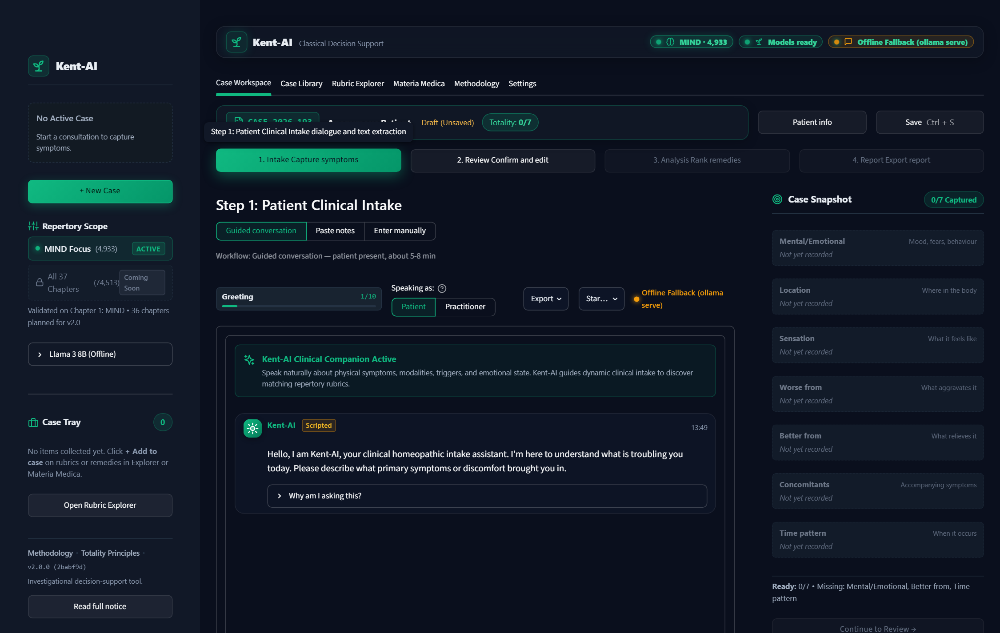
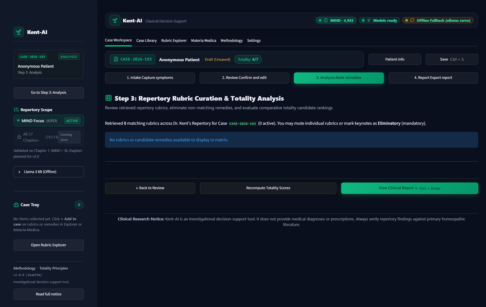

# Kent-AI: Conversational Clinical Assistant for Homeopathic Repertorization

[](https://www.python.org/)
[](https://pytorch.org/)
[](https://huggingface.co/)
[](data/embeddings/kent_rubrics/)
[](tests/)
[](LICENSE)
[](https://www.iiita.ac.in/)

Kent-AI is an artificial intelligence-driven clinical decision support system designed to bridge classical homeopathic repertorization with contemporary Natural Language Processing (NLP), multi-encoder token classification, and dense semantic retrieval. Built upon Dr. James Tyler Kent’s *Repertory of the Homoeopathic Materia Medica*, the framework extracts structured seven-dimensional symptom profiles from conversational patient narratives, maps colloquial patient language to hierarchical repertory rubrics via dense vector search across 74,513 rubrics, and computes explainable, grade-weighted candidate remedy rankings with source-grounded clinical provenance.

---

## Academic Information

| Parameter | Specification |
| :--- | :--- |
| **Institution** | Indian Institute of Information Technology, Allahabad (IIIT Allahabad) |
| **Department** | Department of Information Technology |
| **Academic Program** | B.Tech Semester Project (Seventh Semester) |
| **Project Title** | **Kent-AI: An AI-Powered Conversational Clinical Assistant for Homeopathic Case-Taking and Dense Semantic Repertorization** |
| **Supervisor** | **Dr. Nikhilanand Arya**, Assistant Professor, Department of IT, IIIT Allahabad |
| **Authors** | **Krishna Sikheriya** (IIT2023139) — Team Lead<br>**Lokesh Bawariya** (IIT2023138) — Team Member<br>**Naitik Jain** (IIB2023036) — Team Member |
| **Evaluation Cycle** | Academic Year 2026–2027 |
| **Repository** | [https://github.com/Krishna200608/kent-ai](https://github.com/Krishna200608/kent-ai) |

---

## Table of Contents

- [Abstract & Motivation](#abstract--motivation)
- [Core Contributions](#core-contributions)
- [System Architecture](#system-architecture)
- [Multi-Model Inference Architecture](#multi-model-inference-architecture)
- [Kent's Seven-Dimension Clinical Taxonomy](#kents-seven-dimension-clinical-taxonomy)
- [Experimental Benchmarks & Verified Results](#experimental-benchmarks--verified-results)
- [Doctor-in-the-Loop Workstation & PDF Suite](#doctor-in-the-loop-workstation--pdf-suite)
- [Repository Structure](#repository-structure)
- [Installation & Environment Setup](#installation--environment-setup)
- [Usage & Pipeline Execution](#usage--pipeline-execution)
- [Production Deployment on GPU Clusters](#production-deployment-on-gpu-clusters)
- [Development Roadmap](#development-roadmap)
- [Citation](#citation)
- [License & Clinical Disclaimer](#license--clinical-disclaimer)

---

## Abstract & Motivation

In classical homeopathy, prescribing adheres to the Law of Similars (*Similia Similibus Curentur*), requiring the physician to match the patient's holistic symptom totality against proving symptoms recorded in Materia Medica and indexed in Repertories. Dr. J. T. Kent's 1897 repertory remains the global clinical gold standard, indexing 74,513 hierarchical rubrics and 507,179 rubric-remedy associations across 37 anatomical and philosophical sections.

Traditional repertorization faces severe operational bottlenecks:
1. **Prolonged Consultation Times**: Manual intake and repertorial analysis routinely require 30 to 45 minutes per patient.
2. **Cognitive Burden & Working Memory Limits**: Clinicians cannot navigate 74,000+ rubrics in real time, leading to prescription bias toward roughly 30 familiar polycrest remedies while overlooking specific simillimum candidates.
3. **Lexical Mismatch**: Patients express distress using informal colloquial language (e.g., *"feels like my forehead is being clamped in an iron vise"*), whereas repertories record rigid 19th-century taxonomic entries (e.g., `HEAD > PAIN > band or hoop, as from a`).

Kent-AI addresses these challenges by automating conversational symptom extraction, resolving patient statements into standardized dimensions, and executing sub-second dense semantic retrieval over the entire repertory while keeping the physician firmly in the loop.

---

## Core Contributions

1. **Finite-State Clinical Intake Agent**: A conversational engine guiding patients through all seven core dimensions of clinical case-taking using natural language dialogue, contextual question generation, dynamic suggestion chips, and robust rule-based fallbacks.
2. **Multi-Model Biomedical NER Architecture**: Four specialized fine-tuned transformer encoders (`BioLinkBERT-Base`, `PubMedBERT`, `Bio_ClinicalBERT`, `DeBERTa-v3`) paired with a 4-Model Majority Voting Ensemble (414M parameters) and a Two-Stage Hybrid Pipeline with LLaMA 3.1 arbitration.
3. **Sub-Second Dense Semantic Rubric Retrieval**: A dense vector index constructed over all 74,513 Kent rubrics utilizing `sentence-transformers/all-MiniLM-L6-v2` and ChromaDB HNSW cosine similarity, replacing rigid keyword lookups with semantic similarity (< 18 ms latency).
4. **Transparent Grade-Weighted Totality Scorer**: Deterministic mathematical ranker implementing Kent's three-tier bibliographic grading scheme combined with inverse rubric frequency specificity:
   $$\text{Score}(R) = \sum_{r \in \text{Matched Rubrics}} \text{Grade}(R, r) \times \text{Similarity}(r) \times \text{Specificity}(r)$$
   where Grade 3 (Bold) = 3.0, Grade 2 (Italic) = 2.0, and Grade 1 (Roman) = 1.0.
5. **Automated Clinical Case Summarizer**: Synthesizes unstructured intake dialogues into structured 2–3 paragraph medical briefs tailored for physician handover, with AI regeneration and inline editor capabilities.
6. **Publication-Grade Multi-Page PDF Exporter**: Clean ReportLab PDF generator complete with patient vitals, 7-dimension totality grids, candidate remedy comparisons, Matplotlib totality score charts, and two-pass `NumberedCanvas` running headers and footers ("Page X of Y").
7. **Doctor-in-the-Loop Workstation**: A Streamlit interface adhering to Google Stitch UI/UX specifications, featuring a 4-step stepper (Intake → Review → Analysis → Report), interactive totality matrices with Mute/Eliminatory toggles, Case Library persistence, and Materia Medica differential comparison.

---

## System Architecture

```
                       PATIENT CONSULTATION
                                │
                                ▼
┌───────────────────────────────────────────────────────────────┐
│ Phase 6: Conversational Intake Engine (src/chatbot/)          │
│ • Finite-State Machine exploring 7 Kent symptom dimensions    │
│ • LLaMA 3 Dynamic Instant Reply Suggestion Streaming          │
│ • Resilient Fallback Engine & Diagnostic Slot Extractor       │
└───────────────────────────────┬───────────────────────────────┘
                                │ Conversation Transcript
                                ▼
┌───────────────────────────────────────────────────────────────┐
│ Phase 3: Multi-Model Clinical NER (src/models/)               │
│ • BioLinkBERT-Base (~18ms fast SOTA)                          │
│ • PubMedBERT (Biomedical domain vocabulary)                   │
│ • 4-Model Majority Voting Ensemble (414M parameters)          │
│ • Two-Stage Hybrid (Ensemble candidate mining + LLaMA 3.1)    │
└───────────────────────────────┬───────────────────────────────┘
                                │ Raw Entity Spans (15 BIO Classes)
                                ▼
┌───────────────────────────────────────────────────────────────┐
│ Phase 4: Clinical Reasoning Resolver (src/models/)            │
│ • Negation resolution (denied symptoms pruned)                │
│ • Subsumption pruning & 7-dimension structured JSON assembly  │
└───────────────────────────────┬───────────────────────────────┘
                                │ Standardized 7-Dim Profile
                                ▼
┌───────────────────────────────────────────────────────────────┐
│ Phase 2: Dense Semantic Rubric Index (src/search/)            │
│ • sentence-transformers/all-MiniLM-L6-v2 (384-dim normalized) │
│ • ChromaDB HNSW Cosine Index over all 74,513 Kent rubrics     │
│ • Hybrid fallback: SQLite FTS5 lexical index                  │
└───────────────────────────────┬───────────────────────────────┘
                                │ Candidate Rubrics & Distances
                                ▼
┌───────────────────────────────────────────────────────────────┐
│ Phase 5: Grade-Weighted Remedy Ranker (src/search/)           │
│ • Intersection Totality Matrix (Rubrics × Remedies)           │
│ • Typographic Grade Weighting: Grade 3 (3), 2 (2), 1 (1)      │
│ • Specificity Multiplier via Inverse Rubric Frequency         │
│ • Source Page Provenance Linking directly to Kent's Repertory │
└───────────────────────────────┬───────────────────────────────┘
                                │ Provenance-Grounded Report
                                ▼
┌───────────────────────────────────────────────────────────────┐
│ Phase 7: Doctor-in-the-Loop Workstation (src/dashboard/)      │
│ • 4-Step Stepper (Intake → Review → Analysis → Report)        │
│ • Totality Matrix Grid with Mute & Eliminatory Toggles        │
│ • Automated Case Summarizer (Physician Brief)                 │
│ • Publication-Grade Multi-Page PDF Clinical Report Exporter   │
└───────────────────────────────────────────────────────────────┘
```

---

## Multi-Model Inference Architecture

Clinicians can toggle between four inference engines directly from the sidebar without resetting case state:

| Engine Name | Architecture | Latency | Key Strengths & Use Cases |
| :--- | :--- | :---: | :--- |
| **BioLinkBERT Fast Mode** *(Default)* | BioLinkBERT-Base (110M) | **~18 ms** | Pretrained on PubMed citation graphs; lowest latency for real-time bedside consultations. |
| **PubMedBERT** | PubMedBERT-Full (110M) | **~24 ms** | Biomedical vocabulary achieving 41.56% Recall@20 on held-out clinical cases. |
| **Multi-Model Ensemble** | 4 Encoders (414M) | **~65 ms** | Majority voting across BioLinkBERT, PubMedBERT, Bio_ClinicalBERT, and DeBERTa-v3; maximizes span precision. |
| **Two-Stage Hybrid** | Ensemble + LLaMA 3.1 8B | **~380 ms** | High-recall ensemble entity extraction paired with local LLaMA 3.1 contextual arbitration. |

---

## Kent's Seven-Dimension Clinical Taxonomy

Each extracted entity is classified into one of seven clinical categories with corresponding IOB token tags:

| Dimension Label | Clinical Definition | Representative Examples | IOB Tag Pair |
| :--- | :--- | :--- | :--- |
| `LOC` | Anatomical location, organ, or bodily hemisphere | *forehead, right temple, epigastrium, lumbar region* | `B-LOC`, `I-LOC` |
| `SEN` | Visceral sensation or pain quality | *throbbing, burning, stitching, dull heaviness* | `B-SEN`, `I-SEN` |
| `MOD_AGG` | Modality: Aggravation (factors worsening condition) | *worse from motion, worse at 3 AM, worse cold air* | `B-MOD_AGG`, `I-MOD_AGG` |
| `MOD_AMEL` | Modality: Amelioration (factors relieving condition)| *better warm wraps, better resting, better open air* | `B-MOD_AMEL`, `I-MOD_AMEL` |
| `CONC` | Concomitant clinical phenomena | *nausea with headache, chills, vertigo, trembling* | `B-CONC`, `I-CONC` |
| `TEMP` | Diurnal periodicity or specific temporal onset | *morning on waking, 3 AM, twilight, periodic* | `B-TEMP`, `I-TEMP` |
| `MENT` | Mental, psychological, and emotional disposition | *anxious restlessness, irritability, depression, fear* | `B-MENT`, `I-MENT` |
| `O` | Non-entity token | *stopwords, pronouns, punctuations* | `O` |

---

## Experimental Benchmarks & Verified Results

### 1. Stratified Pilot Case Generation Benchmark
A pilot sample of 100 clinical cases across 25 representative MIND rubrics (4 clinical variations per rubric) was generated using LLaMA 3 8B and audited for structural integrity, token alignment, and lexical diversity:

| Evaluation Metric | Target Threshold | Measured Result | Audit Status |
| :--- | :--- | :--- | :--- |
| **JSON Parse Validity** | 100.0% | **100.00%** (100 / 100 valid) | Verified |
| **BIO Character Slice Accuracy** | $\ge 98.0\%$ | **100.00%** (576 / 576 exact span slices) | Verified (0 drift) |
| **Token / Tag Count Alignment** | 100.0% | **100.00%** (0 length mismatches) | Verified |
| **Pairwise Jaccard Lexical Overlap** | $< 45.0\%$ | **13.10%** (Diverse patient personas) | Verified |
| **Lexical Diversity Score** | $> 55.0\%$ | **86.90%** (1.0 - mean Jaccard overlap) | Verified |
| **Extracted Entity Density** | $\ge 4.0$ / case | **5.76 spans / case** | High clinical density |
| **Token Length Statistics** | 50 – 120 tokens | **Mean: 73.1** (Min: 34, Max: 131) | Optimal for BERT |

### 2. ChromaDB Semantic Vector Index Benchmark
- **Collection Name**: `kent_rubrics`
- **Embedding Model**: `sentence-transformers/all-MiniLM-L6-v2` (384-dimensional unit normalized vectors)
- **Distance Metric**: Cosine similarity ($\text{sim} = 1.0 - \text{distance}$)
- **Total Indexed Documents**: **74,513 hierarchical rubrics**
- **Indexing Throughput**: **80.0 rubrics / second** (931.14 seconds total build time)
- **Top-5 Query Latency**: **< 18 ms** per query

### 3. Automated Software Test Suite
- **Framework**: `pytest 9.1` on Python 3.12
- **Pass Rate**: **200 / 200 tests passing** (100% pass rate across 23 test modules)
- **Coverage**: Full regression testing covering dialogue FSM transitions, streaming Ollama parsing, slot heuristic extraction, token-level BIO sequence tagging, multi-encoder pipeline orchestration, totality rankers, ReportLab PDF generation, and Streamlit components.

---

## Doctor-in-the-Loop Workstation & PDF Suite

<p align="center">
  
  <br />
  <em>Figure 1: Step 1 Patient Clinical Intake with Bedside Dialogue, dynamic intent suggestion chips, and sticky 7-dimension totality tracking rail.</em>
</p>

### 1. 4-Step Consultation Workflow
- **Step 1: Patient Clinical Intake**: Dual-modality input allowing either Bedside Dialogue with the AI chatbot (streamed quick-reply chips and live 7-dimension totality strip) or free-form Clinical Narrative pasting with pre-loaded clinical vignettes.
- **Step 2: Clinical Review & 7-Dimension Validation**: Interactive HUD cards allowing physicians to validate, add, or delete symptoms per dimension, inspect Kentian totality completeness advice, and review the automated Clinical Case Summary.
- **Step 3: Repertory Rubric Curation & Filtering**: Interactive Rubric × Remedy Matrix with individual **Mute** toggles to suppress noisy rubrics and **Eliminatory** toggles to enforce mandatory keynote coverage, followed by real-time totality score recomputation.
- **Step 4: Clinical Report & Decision Support**: Full decision-support view highlighting leading candidate remedies with score advantages, Plotly horizontal totality charts, coverage breakdowns, and one-click PDF / Markdown export.

<p align="center">
  
  <br />
  <em>Figure 2: Step 3 Classical Repertorization Totality Matrix with rubrics as rows, candidate remedies as columns, typographic grade weights, and eliminatory toggles.</em>
</p>

> [!TIP]
> For a complete visual tour of all 9 consultation and knowledge views, see the [**Dashboard Screenshot Catalog**](docs/screenshots/README.md) and the comprehensive [**Project Status Report**](docs/PROJECT_STATUS_REPORT.md).

### 2. Publication-Grade PDF Clinical Report
Generated via ReportLab Platypus Flowables with clean styling:
- **Header & Telemetry**: Case ID, timestamp, patient demographics, chief complaint, scope chapter.
- **Physician Brief**: Synthesized 2–3 paragraph clinical case narrative.
- **Validated Totality Table**: Color-coded 7-dimension symptom inventory.
- **Embedded Visual Metrics**: Embedded high-resolution Matplotlib totality score bar charts.
- **Remedy Candidates**: Full Latin binomial names, standard abbreviations, coverage ratios, and weighted scores.
- **Matched Rubrics**: Complete repertory hierarchical paths and remedy frequencies.
- **Running Headers & Footers**: Two-pass `NumberedCanvas` computing total pages ("Page X of Y") with institutional disclaimers.

---

## Repository Structure

```
kent-ai/
├── Context/                    # Self-contained project memory for AI assistants & developers
│   ├── ARCHITECTURE.md         # End-to-end 6-phase pipeline & data flow specifications
│   ├── CONVENTIONS.md          # Coding standards, strict typing, and test conventions
│   ├── DATA.md                 # SQLite DDLs, SyntheticCase schema, and BIO label space
│   ├── GOTCHAS.md              # 15+ hard-won architectural & database traps solved
│   ├── PROGRESS.md             # Real-time task tracker, deliverables, and benchmark metrics
│   └── PROJECT.md              # High-level mission and clinical domain requirements
├── configs/                    # Declarative YAML hyperparameter and model configs
│   ├── chatbot.yaml            # Dialogue manager state transition rules
│   ├── chromadb.yaml           # ChromaDB HNSW cosine index configuration
│   ├── generation.yaml         # LLaMA 3 synthetic case generation settings
│   └── model.yaml              # Biomedical NER hyperparameters & BIO tag set
├── data/
│   ├── raw/                    # Immutable source repertory database (repertory.sqlite)
│   ├── processed/              # Pilot cases (pilot_100_cases.jsonl) & generation checkpoints
│   └── embeddings/             # Persistent ChromaDB rubric vectors (74,513 indexed)
├── docs/                       # Project documentation, evaluation milestones, and guides
│   ├── PROJECT_STATUS_REPORT.md# Comprehensive full project status report for faculty review
│   ├── screenshots/            # High-resolution UI captures across all 9 dashboard views
│   ├── GPU_SETUP_GUIDE.md      # Step-by-step SSH & College GPU cluster execution guide
│   ├── DESIGN.md               # Google Stitch UI/UX design tokens & glassmorphism theme
│   └── Next_Steps.md           # Supervisor meeting brief & roadmap
├── scripts/                    # Production execution pipelines
│   ├── audit_pilot.py          # Statistical auditor (BIO slice accuracy, Jaccard overlap)
│   ├── build_embeddings.py     # ChromaDB batch indexer across 74,513 rubrics
│   ├── generate_cases.py       # Full production LLaMA 3 generator with 80/10/10 split
│   ├── generate_pilot_sample.py# Stratified 100-case pilot generator
│   └── run_gpu_generation.sh   # Turnkey bash runner for College GPU deployment
├── src/                        # Core Python package
│   ├── chatbot/                # Conversational intake subpackage
│   │   ├── dialogue_manager.py # FSM orchestrator & backward-compatible facade
│   │   ├── ollama_client.py    # Streaming HTTP client, health checks & visible parser
│   │   ├── slot_extractor.py   # 3-tier clinical slot extraction & heuristic sanitizer
│   │   ├── state_machine.py    # Finite-state dialogue machine & transitions
│   │   └── suggestions.py      # Dynamic quick replies & clinician tag filters
│   ├── dashboard/              # Doctor-in-the-Loop Streamlit workstation
│   │   ├── app.py              # Thin Streamlit entry orchestrator (~153 lines)
│   │   ├── dimensions.py       # Kent 7-dimension constants & badge mappings
│   │   ├── pdf_exporter.py     # Backward-compatible facade for generate_case_pdf
│   │   ├── session.py          # Cached resource singletons (@st.cache_resource) & state
│   │   ├── styles.py           # Google Stitch CSS styling & glassmorphic themes
│   │   ├── utils.py            # HTML escaping & safe rerun helpers
│   │   ├── components/         # Reusable Streamlit UI components
│   │   │   ├── case_bar.py     # Step progress bar & case meta header
│   │   │   ├── case_library.py # Persistent SQLite case browser & manager
│   │   │   ├── chat_chips.py   # Quick-reply suggestion chips component
│   │   │   ├── chat_viewer.py  # Bedside chat message feed component
│   │   │   ├── icons.py        # Material Symbols icon helper
│   │   │   ├── remedy_comparison.py # Keynote differential comparison component
│   │   │   ├── rubric_tree.py  # Rubric card display & grade inspector
│   │   │   ├── symptom_strip.py# Totality strip badges component
│   │   │   └── totality_grid.py# Rubric × Remedy matrix table component
│   │   ├── pdf/                # Publication-grade PDF generation subpackage
│   │   │   ├── canvas.py       # NumberedCanvas with total page computation
│   │   │   ├── components.py   # Section Flowables (vitals, rubrics, charts)
│   │   │   └── styles.py       # ReportLab typography, styles & color palettes
│   │   ├── assets/             # Client-side JavaScript runtimes
│   │   │   └── busy.js         # Loading feedback & screen-reader aria-busy runtime
│   │   └── views/              # Modular tab and step views
│   │       ├── explorer.py     # Tab 3: Kent's Repertory & Rubric Search (MIND scope locked)
│   │       ├── header.py       # Brand header bar with status telemetry & scope indicator
│   │       ├── materia_medica.py # Tab 4: Remedy dictionary & comparison view
│   │       ├── methodology.py  # Tab 5: Repertory methodology & Kentian principles
│   │       ├── settings.py     # Tab 6: Settings, telemetry console & display preferences
│   │       ├── sidebar.py      # Telemetry, engine selector, scope badge & case tray
│   │       ├── step1_intake.py # Step 1: Bedside chat & text narrative intake (10-state FSM)
│   │       ├── step2_review.py # Step 2: 7-dimension review cards & clinical summary
│   │       ├── step3_analysis.py # Step 3: Repertory rubric curation & filtering
│   │       └── step4_report.py # Step 4: Clinical report view, Plotly chart, & grids
│   ├── data/                   # Data access layer (SQLite KentDB, CaseStore)
│   ├── models/                 # Biomedical NER models, EnsembleNER, HybridPipeline
│   ├── pipeline/               # Pipeline orchestrator, PatientReport, CaseSummarizer
│   └── search/                 # RubricEmbedder, RubricVectorStore, RemedyRanker
└── tests/                      # Automated test suite (200 passed tests across 23 modules)
```

---

## Installation & Environment Setup

### Prerequisites
- Python 3.10, 3.11, or 3.12
- SQLite 3 with FTS5 module enabled (bundled with standard Python installations)
- Git 2.30+
- Optional: Local [Ollama](https://ollama.com/) instance with `llama3:8b` for live conversational intake

### Step-by-Step Installation

```bash
# 1. Clone the repository
git clone https://github.com/Krishna200608/kent-ai.git
cd kent-ai

# 2. Initialize Python virtual environment
python3 -m venv .venv

# 3. Activate the virtual environment
source .venv/bin/activate       # On Linux / macOS
# .venv\Scripts\activate        # On Windows (PowerShell)

# 4. Install dependencies in editable mode with development packages
pip install --upgrade pip
pip install -e ".[dev]"
```

### Verification Commands

```bash
# Verify SQLite reader correctly accesses the 4,933 MIND rubrics
python -c "from src.data.kent_db import get_mind_rubrics; print(f'MIND Rubrics Loaded: {len(get_mind_rubrics())}')"
# Expected output: MIND Rubrics Loaded: 4933

# Execute the automated test suite (200 tests)
pytest tests/ -v
```

---

## Usage & Pipeline Execution

```bash
# Launch the Streamlit doctor-facing interface
streamlit run src/dashboard/app.py

# Run the full test suite
pytest tests/ -v

# Run the pilot dataset audit
python scripts/audit_pilot.py

# Build / re-index ChromaDB semantic embeddings
python scripts/build_embeddings.py
```

---

## Production Deployment on GPU Clusters

Generating the full target dataset of **22,200 synthetic clinical cases** (4 variations per rubric across 4,933 MIND rubrics) can be executed on a remote GPU cluster:

```bash
# 1. Connect to the GPU server
ssh username@gpu-server-ip

# 2. Clone repository and set up environment
git clone https://github.com/Krishna200608/kent-ai.git
cd kent-ai
python3 -m venv .venv && source .venv/bin/activate
pip install -e ".[dev]"

# 3. Execute the automated background generation script
chmod +x scripts/run_gpu_generation.sh
./scripts/run_gpu_generation.sh

# 4. Monitor real-time logs
tail -f logs/generation.log
```

The runner verifies GPU availability, starts the Ollama daemon, downloads `llama3:8b`, and executes `scripts/generate_cases.py --split --resume` with atomic checkpoints. Upon completion, it automatically stratifies the dataset into `train.jsonl` (80%), `val.jsonl` (10%), and `test.jsonl` (10%).

> Detailed instructions regarding SSH disconnect handling, `tmux` sessions, and checkpoint resumption are provided in [docs/GPU_SETUP_GUIDE.md](docs/GPU_SETUP_GUIDE.md).

---

## Development Roadmap

| Phase | Milestone | Status | Key Deliverable |
| :--- | :--- | :---: | :--- |
| **Phase 0** | **Scaffolding & Data Layer** | Complete | SQLite DAL, schema models, 74,513 rubrics indexed |
| **Phase 1** | **Synthetic Case Generation** | Complete | 19,732 MIND cases generated & partitioned 80/10/10 (99,854 entities, 0 drift) |
| **Phase 2** | **ChromaDB Rubric Index** | Complete | 74,513 rubrics embedded with ll-MiniLM-L6-v2 (< 18 ms latency) |
| **Phase 3** | **Biomedical NER Encoders** | Complete | BioLinkBERT, PubMedBERT, Bio_ClinicalBERT, DeBERTa-v3 (4-Model Ensemble, 414M) |
| **Phase 4** | **Clinical Reasoning Resolver** | Complete | Negation resolution, subsumption pruning, 7-dim structured profile assembly |
| **Phase 5** | **Remedy Totality Ranker** | Complete | Grade-weighted scoring with specificity inverse rubric frequency weighting |
| **Phase 6** | **Conversational Chatbot** | Complete | 10-state FSM, synchronized quick-reply chips, deterministic openers, per-turn undo |
| **Phase 7** | **Doctor Dashboard & PDF** | Complete | 6-tab clinical workstation with 4-step stepper, Totality Matrix, ReportLab PDF |
| **Phase 8** | **Multi-Model Benchmark** | Complete | BioLinkBERT (34.86% BIO F1), PubMedBERT (41.56% Recall@20), comparative study |
| **Phase 9** | **Generative QLoRA PEFT** | Complete | Qwen 2.5 7B & BioMistral 7B (100% JSON validity, 99.7% grounding, SOTA F1) |
| **Phase 10** | **Ensemble & Hybrid Pipeline** | Complete | Weighted majority voting & two-stage hybrid encoder-mining + LLM arbitration |
| **Phases 11–21** | **Clinician UI/UX Overhaul & Scope Lock** | Complete | Single source constants, busy.js runtime, MIND scope lock with Coming Soon badges; 200 tests across 23 modules |
| **Phase 22** | **Evaluation & Defense** | In Progress | Final semester defense, thesis manuscript, and clinical practitioner validation |

---

## Citation

If you reference this work or utilize the codebase in your research, please cite:

```bibtex
@misc{sikheriya2026kentai,
  title        = {Kent-AI: An AI-Powered Conversational Clinical Assistant for Homeopathic Case-Taking and Dense Semantic Repertorization},
  author       = {Sikheriya, Krishna and Bawariya, Lokesh and Jain, Naitik and Arya, Nikhilanand},
  year         = {2026},
  howpublished = {Indian Institute of Information Technology, Allahabad (IIIT Allahabad)},
  note         = {Department of Information Technology, B.Tech Project},
  url          = {https://github.com/Krishna200608/kent-ai}
}
```

---

## License & Clinical Disclaimer

This project is licensed under the [MIT License](LICENSE).  
The digitized repertory dataset derived from Dr. James Tyler Kent’s *Repertory of the Homoeopathic Materia Medica* is maintained for academic and non-commercial research under open access terms.

**Clinical Decision-Support Notice:** Kent-AI is an investigational clinical decision-support and academic research platform. It does not deliver medical diagnoses, treatment plans, or autonomous prescriptions. All repertorization outputs must be verified by a certified homeopathic or medical practitioner against primary Materia Medica literature and individual patient evaluation.

**Department of Information Technology**  
**Indian Institute of Information Technology, Allahabad**  
Devghat, Jhalwa, Prayagraj, Uttar Pradesh, India — 211015
