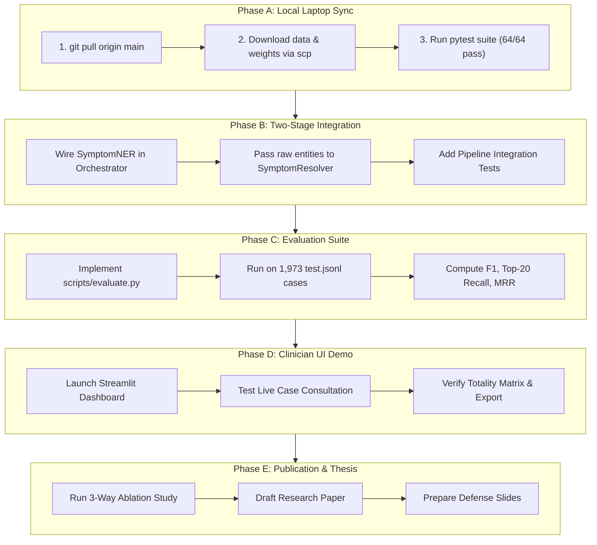

# Kent-AI: Next-Steps Implementation Plan

> **Project**: Kent-AI — AI-Powered Clinical Assistant for Homeopathic Repertorization  
> **Repository**: [Krishna200608/kent-ai](https://github.com/Krishna200608/kent-ai)  
> **Local Target Environment**: `D:\Research Project\kent-ai` (Windows 11 / PowerShell)  
> **Server Reference Environment**: College GPU Server (`172.20.70.80`, NVIDIA RTX 5000 Ada)  
> **Date**: October 2026  
> **Version**: 2.0 (Post-Phase 1 & Phase 3 Production Completion)

---

## 1. Executive Context & Milestone Ledger

All foundational and computationally heavy pipeline milestones have been successfully engineered, verified, and executed on the College GPU server:

- **Phase 0 (Data Layer & DAL)**: SQLite access layer for Kent's 74,513 rubrics, 37 sections, and 507,179 remedy mappings (`src/data/kent_db.py`).
- **Phase 1 (Synthetic Case Generation)**: **100% Complete** — 19,732 clinical cases generated across all 4,933 Chapter 1 (MIND) rubrics with 0 character offset drift, partitioned into 80/10/10 splits (`train.jsonl`, `val.jsonl`, `test.jsonl`).
- **Phase 2 (Dense Vector Index)**: ChromaDB persistent vector collection with 74,513 rubrics indexed via `all-MiniLM-L6-v2` (`src/search/vector_store.py`).
- **Phase 3 (HomeoNER Model Training)**: **100% Complete** — `emilyalsentzer/Bio_ClinicalBERT` fine-tuned on the 15-class BIO schema across 7 clinical dimensions; optimal weights exported to `data/models/clinicalbert_homeoNER/` (`model.safetensors`, 411 MB).
- **Test Suite**: **64 / 64 unit and integration tests passing** (`pytest tests/ -v`).

The upcoming work transitions from **server-side model training** to **local two-stage integration, quantitative test evaluation, clinician portal demo, and publication writing**.

---

## 2. Phase-by-Phase Implementation Roadmap



---

## 3. Detailed Work Breakdown

### Phase A: Local Laptop Environment Sync & Verification

**Objective**: Ensure your Windows laptop environment (`D:\Research Project\kent-ai`) is fully identical to the GPU server's state.

1. **Pull Code and Scripts**:
   ```powershell
   cd "D:\Research Project\kent-ai"
   git pull origin main
   ```
2. **Download Model Weights & Processed Dataset**:
   ```powershell
   # Create target directories
   New-Item -ItemType Directory -Force -Path "data\models"
   New-Item -ItemType Directory -Force -Path "data\processed"

   # Download fine-tuned ClinicalBERT (411 MB)
   scp -r narya@172.20.70.80:~/kent-ai/data/models/clinicalbert_homeoNER "data\models\"

   # Download dataset archive (15 MB) & unpack
   scp narya@172.20.70.80:~/kent-ai/data/processed/kent_mind_dataset.tar.gz "data\processed\"
   tar -xzf "data\processed\kent_mind_dataset.tar.gz" -C "data\processed\"
   ```
3. **Check Database & ChromaDB Index**:
   ```powershell
   # Confirm SQLite DB exists:
   Test-Path "data\raw\repertory.sqlite"

   # Confirm or build ChromaDB embeddings:
   if (-not (Test-Path "data\embeddings\kent_rubrics")) {
       python scripts\build_embeddings.py
   }
   ```
4. **Execute Local Test Suite**:
   ```powershell
   .venv\Scripts\pytest tests\ -v
   ```
   *Acceptance Criteria*: 64 passed tests.

---

### Phase B: Two-Stage Pipeline Orchestrator Integration

**Objective**: Wire the fine-tuned `SymptomNER` model directly into the primary execution loop in `src/pipeline/orchestrator.py`.

#### Implementation Details:
1. **Initialize `SymptomNER` in `PipelineOrchestrator.__init__`**:
   - Load fine-tuned weights from `data/models/clinicalbert_homeoNER/` (with fallback to rule-based mock mode if weights are missing).
2. **Update `process_transcript()`**:
   - **Step 1**: Pass narrative transcript through `SymptomNER.extract_entities(transcript)` to obtain 7-dimension entity spans (`LOC`, `SEN`, `MOD_AGG`, `MOD_AMEL`, `CONC`, `TEMP`, `MENT`) with confidence scores.
   - **Step 2**: Feed `raw_entities` directly into `SymptomResolver.resolve(transcript, raw_entities=raw_entities)`.
   - **Step 3**: `SymptomResolver` uses LLaMA 3 to filter negations (e.g., *"no headache"*, *"denies chills"*), resolve coreferences, and construct the finalized `SymptomProfile`.
   - **Step 4**: Query ChromaDB with composite queries from the profile $\to$ rank candidate remedies via Kent's 3-grade totality ranker $\to$ emit `PatientReport`.
3. **Integration Tests**:
   - Add new end-to-end tests in `tests/test_pipeline.py` verifying NER span extraction feeding into resolver output.

---

### Phase C: Comprehensive Academic Evaluation Suite

**Objective**: Complete `scripts/evaluate.py` to run quantitative benchmarks over the held-out test split (`data/processed/test.jsonl`, 1,973 cases).

#### Target Academic Metrics:
1. **Token & Entity-Level HomeoNER Metrics (SeqEval)**:
   - Precision, Recall, and $F_1$ overall and broken down across all 7 dimensions.
2. **Rubric Retrieval Recall**:
   $$\text{Recall@}K = \frac{1}{|D|} \sum_{i=1}^{|D|} \mathbb{I}(\text{true\_rubric}_i \in \text{Top-}K(\text{Retrieved}_i))$$
   - Evaluate for $K \in \{1, 5, 10, 20\}$. Target: $\text{Recall@20} \ge 90\%$.
3. **Mean Reciprocal Rank (MRR)**:
   $$\text{MRR} = \frac{1}{|D|} \sum_{i=1}^{|D|} \frac{1}{\text{rank}_i}$$
   - Target: $\text{MRR} \ge 0.65$.
4. **Remedy Indication Accuracy**:
   - Percentage of cases where the ground-truth simillimum remedy appears in Top-1, Top-3, and Top-5 ranked remedies.
5. **Output Reports**:
   - Export structured JSON metrics to `data/eval_metrics.json`.
   - Export clinical publication table to `docs/Evaluation/test_benchmark_results.md`.
   - Synchronize with `Context/PROGRESS.md`.

---

### Phase D: Clinician UI Dashboard Demonstration

**Objective**: Verify and demonstrate the doctor-facing Streamlit application (`src/dashboard/app.py`) with real model inference.

1. **Launch Command**:
   ```powershell
   streamlit run src/dashboard/app.py
   ```
2. **Verification of Clinical Workspaces**:
   - **Workspace 1: Conversational Intake**: Test multi-turn symptom collection with the 10-state FSM agent.
   - **Workspace 2: Clinical Repertorization**: Input unstructured patient case narratives; confirm live ClinicalBERT span highlights and composite rubric retrieval.
   - **Workspace 3: Interactive Totality Matrix**: Validate rubric-by-remedy grid with Kentian grading ($3=\text{Bold}, 2=\text{Italics}, 1=\text{Roman}$).
   - **Workspace 4: Case Tray & Export**: Verify 1-click Markdown / PDF clinical repertorization report download.

---

### Phase E: Ablation Study & Research Publication

**Objective**: Quantify the neural-symbolic contribution and draft the thesis / paper manuscript.

1. **Ablation Comparison Matrix**:
   | Pipeline Configuration | NER Extractor | Retrieval Method | Ranking Logic |
   | :--- | :--- | :--- | :--- |
   | **Baseline 1 (Lexical)** | Regex / None | SQLite FTS5 / BM25 | Pure Term Frequency |
   | **Baseline 2 (Dense Vector)** | None | ChromaDB Embeddings | Cosine Similarity |
   | **Proposed Hybrid (Kent-AI)** | **Bio_ClinicalBERT** | **ChromaDB + Negation Filter** | **Kent's Totality + IRF Weighting** |
2. **Publication Deliverables**:
   - Experimental result tables comparing Recall@K, MRR, and Simillimum Accuracy across configurations.
   - Thesis Defense Presentation Slide Deck (LaTeX Beamer / PPTX).
   - Research Paper draft targeting clinical NLP / AI in Healthcare venues.

---

## 4. Key Verification Checklist for New Chat

When opening your new chat in the local repo (`D:\Research Project\kent-ai`), use this checklist to immediately prompt the assistant:

```markdown
I have synced the repository from GitHub and copied the model weights and datasets.
Current Status:
1. `git pull origin main` executed successfully.
2. `data/raw/repertory.sqlite` verified.
3. `data/processed/train.jsonl`, `val.jsonl`, `test.jsonl` extracted.
4. `data/models/clinicalbert_homeoNER/` contains model.safetensors.
5. All 64 unit tests pass via pytest.

Please proceed with Phase B:
1. Wire `SymptomNER` into `src/pipeline/orchestrator.py`.
2. Add integration tests in `tests/test_pipeline.py`.
3. Implement `scripts/evaluate.py` for Phase C test set benchmarking.
```
