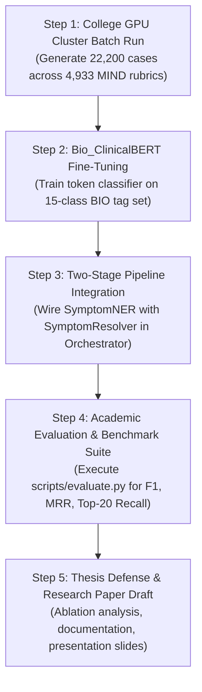

# Kent-AI: Project Status & Next Steps Roadmap

**Project Title**: AI-Powered Clinical Assistant for Homeopathic Repertorization  
**Institution**: Indian Institute of Information Technology, Allahabad (IIIT-A)  
**Research Team**: Krishna Sikheriya (Lead), Lokesh Bawariya, Naitik Jain  
**Supervisor**: Dr. Nikhilanand Arya  
**Date**: October 2026  
**Document Version**: 1.0 (Supervisor Review Draft)

---

## 1. Executive Summary

Kent-AI is an end-to-end clinical decision-support system designed to modernize classical homeopathic repertorization using state-of-the-art Natural Language Processing (NLP) and dense vector retrieval. Based on Dr. James Tyler Kent's *Repertory of the Homoeopathic Materia Medica* (Expanded Edition, 74,513 rubrics, 500,000+ remedy mappings), the system translates unstructured, conversational patient narratives into structured 7-dimensional clinical symptom profiles, performs semantic rubric matching, and outputs a mathematically ranked, provenance-backed differential remedy analysis.

To date, all foundational scaffolding, database layers, dense vector retrieval systems, clinical ranking logic, dialogue state management, and doctor-facing interfaces have been implemented and verified. A pilot validation run of 100 synthetic clinical cases across 25 MIND rubrics demonstrated **100% JSON schema validity**, **100% BIO character offset accuracy** (zero drift), and high entity extraction quality.

This document outlines the current project status, immediate critical-path milestones, resource requirements for the College GPU cluster, and an academic timeline leading to thesis submission and paper publication.

---

## 2. Current Architecture & Completed Milestones

The system architecture follows a modular, layered neural-symbolic design:

```
[Patient Intake Dialogue] 
       │
       ▼
[Bio_ClinicalBERT Token Classifier (HomeoNER)] ──> Extracts 7-Dim BIO Spans (LOC, SEN, MOD, etc.)
       │
       ▼
[LLaMA 3 Clinical Resolver (Ollama)] ────────────> Resolves Negations, Coreferences & Builds Profile
       │
       ▼
[ChromaDB HNSW Vector Store (74,513 Rubrics)] ───> Dense Semantic Retrieval (all-MiniLM-L6-v2)
       │
       ▼
[Classical Kentian Remedy Ranker] ───────────────> Totality Coverage + 3-Grade Weighting + IRF Specificity
       │
       ▼
[Streamlit Clinician Portal] ────────────────────> Totality Matrix, Rubric Explorer & Clinical Report
```

### Component Status Matrix

| Layer / Component | Module Path | Status | Key Metrics / Validation |
|---|---|---|---|
| **Data Layer (Repertory DAL)** | `src/data/kent_db.py` | Complete | SQLite interface over 37 sections, 74,513 rubrics, 507,179 remedy entries. 100% test pass rate. |
| **Synthetic Case Pipeline** | `src/data/case_generator.py`<br>`src/data/bio_tagger.py`<br>`src/data/splitter.py` | Complete | LLaMA 3 prompt synthesis with automated subword BIO token labeling and crash-safe atomic checkpoints. |
| **Pilot 100-Case Benchmark** | `docs/Evaluation/Pilot/pilot_100_cases_evaluation.md` | Validated | 100 cases evaluated: 100% schema validity, 0 offset drift, 5.76 entities/case, 86.9% lexical diversity. |
| **Dense Vector Index** | `src/search/vector_store.py`<br>`src/search/embedder.py` | Complete | All 74,513 rubrics embedded with `all-MiniLM-L6-v2` into ChromaDB HNSW cosine collection. |
| **LLaMA 3 Resolver** | `src/models/resolver.py` | Complete | 7-dimension structuring (`SymptomProfile`), negation detection heuristics, composite ChromaDB query synthesis. |
| **Remedy Ranking Engine** | `src/search/ranker.py` | Complete | Totality rubric intersection, Kent's 3-grade weighting ($3=\text{Bold}, 2=\text{Italics}, 1=\text{Roman}$), and Inverse Remedy Frequency (IRF). |
| **Conversational Chatbot** | `src/chatbot/state_machine.py`<br>`src/chatbot/dialogue_manager.py` | Complete | 10-state FSM clinical intake tracking symptoms across 7 dimensions with empathetic persona and auto-handover. |
| **Clinical UI Dashboard** | `src/dashboard/app.py` | Complete | Streamlit portal (Google Stitch standard): 4 clinical workspaces, interactive Totality Matrix, and 1-click export. |
| **Engineering Skills** | `.agents/skills/` | Complete | 15 specialized development and domain-modeling skills verified and committed. |

---

## 3. Immediate Next Steps & Critical Path

With the pipeline architecture fully implemented and verified via unit tests and pilot benchmarks, the remaining work centers on **large-scale model training, end-to-end quantitative evaluation, and publication preparation**.



### Step 1: Production Batch Generation on College GPU Cluster (Phase 1 Execution)
- **Objective**: Generate the full target dataset of ~22,200 synthetic clinical cases across all 4,933 Chapter 1 (MIND) rubrics with 4 to 5 clinical variations per rubric.
- **Why a GPU is Required**:
  - *Local Laptop (CPU mode)*: 1.30 cases/minute $\rightarrow$ **285 hours (~11.9 days continuous execution)**. This presents significant thermal and hardware risks.
  - *College GPU Server (NVIDIA A100 / RTX 3090/4090 with Ollama CUDA)*: 15–25 cases/minute $\rightarrow$ **14.8 to 24.6 hours total**.
- **Execution Readiness**:
  - Ready-to-run automation script: `scripts/run_gpu_generation.sh`.
  - Step-by-step setup documentation: `docs/GPU_SETUP_GUIDE.md`.
  - Atomic checkpointing (`data/processed/generation_checkpoint.json`) ensures resilience against SSH disconnects or server preemption.
- **Output Artifacts**:
  - `data/processed/train.jsonl` (80% split $\approx$ 17,760 cases)
  - `data/processed/val.jsonl` (10% split $\approx$ 2,220 cases)
  - `data/processed/test.jsonl` (10% split $\approx$ 2,220 cases)

### Step 2: Fine-Tuning Bio_ClinicalBERT for HomeoNER (Phase 3)
- **Objective**: Fine-tune `emilyalsentzer/Bio_ClinicalBERT` on the token-level clinical symptom extraction task.
- **Label Schema**: 15 BIO classes covering Kent's 7 clinical dimensions:
  - `LOC` (Location), `SEN` (Sensation), `MOD_AGG` (Aggravation), `MOD_AMEL` (Amelioration), `CONC` (Concomitant), `TEMP` (Temporal), `MENT` (Mental/Emotional), and `O` (Outside).
- **Target Performance**: Token-level $F_1 \ge 88\%$ evaluated via SeqEval.
- **Platform**: Google Colab T4 GPU (free tier, ~35–50 min training) or College GPU cluster.
- **Implementation State**: `src/models/trainer.py` and `scripts/train_ner.py` are written with PyTorch and Hugging Face Trainer integration.

### Step 3: Two-Stage Pipeline Orchestrator Integration
- **Objective**: Wire the fine-tuned `SymptomNER` model directly into `src/pipeline/orchestrator.py`.
- **Workflow**:
  1. Patient narrative transcript is processed by `SymptomNER` to extract token spans.
  2. Extracted spans are fed into `SymptomResolver` (LLaMA 3) to filter negated symptoms, resolve coreferences, and construct the structured `SymptomProfile`.
  3. `SymptomProfile` generates composite search queries for ChromaDB dense retrieval.
  4. Candidate rubrics are scored by `RemedyRanker` to compute totality coverage and grade-weighted rankings.

### Step 4: Quantitative Evaluation & Benchmark Suite (Phase 5 & 8)
- **Objective**: Implement and run the complete academic benchmark suite (`scripts/evaluate.py`) over the held-out test split (`test.jsonl`).
- **Target Academic Evaluation Metrics**:
  1. **Token Extraction**: Precision, Recall, and $F_1$ score per symptom dimension.
  2. **Rubric Retrieval Recall**: Top-5, Top-10, and Top-20 Recall (Target: $\ge 90\%$ in Top-20).
  3. **Mean Reciprocal Rank (MRR)**: Target $\text{MRR} \ge 0.65$:
     $$\text{MRR} = \frac{1}{|Q|} \sum_{i=1}^{|Q|} \frac{1}{\text{rank}_i}$$
  4. **Simillimum Remedy Accuracy**: Top-1, Top-3, and Top-5 accuracy matching the ground-truth indicated remedy.
  5. **Ablation Study**:
     - Baseline 1: Pure Lexical / Keyword Search (BM25 / SQLite FTS5)
     - Baseline 2: Pure Dense Vector Retrieval (ChromaDB without classical weighting)
     - Proposed System: Hybrid Vector + Classical Kentian Totality & Grade Weighting

---

## 4. Proposed Timeline & Milestone Schedule

| Phase | Milestone | Estimated Duration | Target Completion | Dependencies |
|---|---|---|---|---|
| **Phase 1** | College GPU Batch Generation (~22,200 cases) | 1–2 days | Week 1 | GPU cluster access |
| **Phase 1** | Dataset validation & 80/10/10 split generation | 0.5 day | Week 1 | Batch generation complete |
| **Phase 3** | Bio_ClinicalBERT Fine-Tuning & Validation ($F_1 \ge 88\%$) | 1–2 days | Week 2 | `train.jsonl` & `val.jsonl` |
| **Phase 4/5** | Two-Stage Pipeline Integration & Regression Tests | 2 days | Week 2 | Fine-tuned weights |
| **Phase 5/8** | Comprehensive Evaluation Suite (`scripts/evaluate.py`) | 3 days | Week 3 | `test.jsonl` |
| **Phase 8** | Ablation Study & Result Aggregation | 2 days | Week 3 | Benchmark execution |
| **Phase 8** | Research Paper Draft & Thesis Defense Slides | 5–7 days | Week 4 | Final benchmark results |

---

## 5. Agenda & Discussion Points for Meeting

During our discussion, we seek guidance and approval on the following points:

1. **GPU Cluster Resource Allocation**:
   - Permission and SSH credentials to run Ollama (`llama3:8b`) on the College GPU server for a single batch run of ~15–24 hours.
   - Confirmation of environment restrictions (e.g., Slurm batch script vs. persistent `tmux` session).
2. **Dataset Scale & Rubric Scope**:
   - We currently focus Chapter 1 (MIND, 4,933 rubrics, 22,200 synthetic cases) as our primary benchmark domain due to its high diagnostic complexity. We would like your concurrence on this scope.
3. **Validation by Domain Experts (Optional)**:
   - Feasibility of getting a small sample (e.g., 20–30 cases) reviewed by a practicing homeopathic physician to provide qualitative clinical feedback alongside our quantitative metrics.
